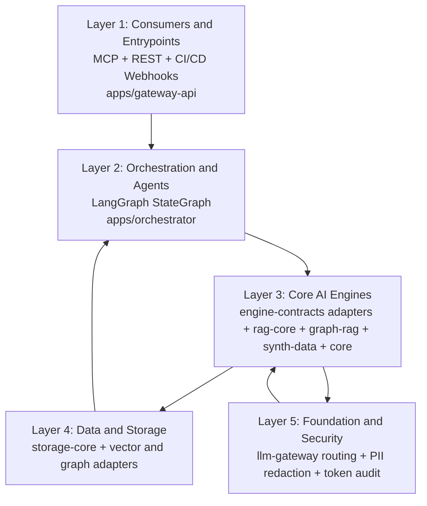
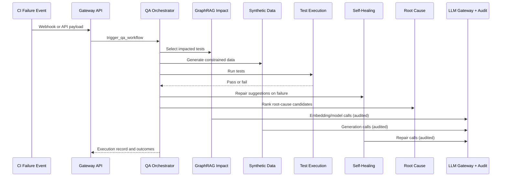

# playwright-bootstrap

A showcase monorepo for modern QA engineering: a production-minded Playwright + TypeScript
framework bootstrap, plus a full AI-Driven QA Platform for impact analysis, root-cause triage,
governed synthetic data, and self-healing locators.

This repository is designed for teams doing serious system integration testing, not only UI
test scripts.

## Why this exists

Most QA programs hit the same scaling pain:

1. CI failures are expensive to triage.
2. UI locator drift burns engineering time.
3. PR blast radius is unclear, so teams over-run tests.
4. Integration test data is hard to generate and keep isolated.
5. AI adoption stalls without governance, redaction, and auditability.

This repo addresses all five with a layered architecture you can run, inspect, and extend.

Start here for product framing and FAQ:
[docs/getting-started.md](docs/getting-started.md)

## What you get

### 1) Framework Bootstrap for QA teams

- `@qaf/core`: Playwright fixtures, Page Object Model base classes, quarantine engine,
  visual and accessibility helpers, data-isolation support, and locator resolver.
- `@qaf/eslint-plugin-qaf`: enforces resolver-first locator usage and bans `console.*`.
- `create-qaf`: `npm create qaf@latest my-suite` scaffolds a full QA suite wired to
  versioned framework packages.
- `template/`: canonical generated-suite template with web/API/mobile examples and CI workflows.

### 2) AI-Driven QA Platform

- RAG coverage and failure clustering (`@qaf/rag-core`)
- GraphRAG impact analysis and root-cause traversal (`@qaf/graph-rag`)
- Governed synthetic data generation and validation (`@qaf/synth-data`)
- Self-healing locator flows (`@qaf/core` + engine adapters)
- Unified orchestration, gateway, and storage layers for auditability and operations

## Platform capability matrix

| Capability | Primary packages | Outcome |
|---|---|---|
| Coverage mapping and failure clustering | `@qaf/rag-core` | Maps specs to tests and groups recurrent failures |
| Impact-aware regression selection | `@qaf/graph-rag` | Selects likely-affected tests from dependency topology |
| Root-cause candidate ranking | `@qaf/graph-rag` + incident similarity | Produces ranked upstream suspects with confidence |
| Synthetic relational test data | `@qaf/synth-data` | Generates validated, constrained, isolated data sets |
| Locator repair proposals | `@qaf/core` + adapters | Recovers brittle selectors and supports PR workflows |
| Unified model governance | `@qaf/llm-gateway` | PII redaction + token audit + routed model calls |
| End-to-end workflow automation | `@qaf/orchestrator` + `@qaf/gateway-api` | Runs one CI failure through all relevant pillars |

## Architecture showcase



Deep technical mapping:
[docs/ai-platform.md](docs/ai-platform.md)

Package-level monorepo map:
[docs/architecture.md](docs/architecture.md)

## Workflow showcase



## Prerequisites

- Node.js `>=20`
- pnpm `9.15.0` (or compatible)

## Quickstart paths

### Evaluate the full AI platform in 5 minutes

```bash
npx pnpm install
pnpm build
pnpm --filter @qaf/gateway-api demo
```

Then run services:

```bash
pnpm --filter @qaf/gateway-api start
pnpm --filter @qaf/gateway-api start:mcp
docker compose up --build
```

### Contribute to this monorepo

```bash
npx pnpm install
pnpm build && pnpm typecheck && pnpm lint && pnpm test
```

Contributor guide:
[docs/contributing.md](docs/contributing.md)

### Adopt the framework in a new QA suite

```bash
npm create qaf@latest my-qa-suite
cd my-qa-suite
pnpm test
```

Generated-suite docs:
[template/README.md](template/README.md)
[template/docs/architecture.md](template/docs/architecture.md)

## Showcase components by area

### Framework engineering

- Fixture architecture and test foundations: [packages/core](packages/core)
- Lint standards and enforcement: [packages/eslint-plugin-qaf](packages/eslint-plugin-qaf)
- Scaffolding and lifecycle: [packages/create-qaf](packages/create-qaf)

### AI platform engineering

- Layer 1 service entrypoints: [apps/gateway-api](apps/gateway-api)
- Layer 2 orchestration graph: [apps/orchestrator](apps/orchestrator)
- Layer 3 engine contracts: [packages/engine-contracts](packages/engine-contracts)
- Layer 4 storage adapters: [packages/storage-core](packages/storage-core)
- Layer 5 model governance: [packages/llm-gateway](packages/llm-gateway)

### Domain engines

- RAG coverage and clustering: [packages/rag-core](packages/rag-core)
- GraphRAG impact and diagnosis: [packages/graph-rag](packages/graph-rag)
- Synthetic data lifecycle: [packages/synth-data](packages/synth-data)

## Maturity and expectations

This is a reference architecture with runnable defaults and clear seams for production wiring.
It is intentionally transparent about what is complete versus what still needs environment-
specific integration.

Maturity details and FAQ:
[docs/getting-started.md](docs/getting-started.md)

## Documentation index

- [docs/getting-started.md](docs/getting-started.md): problem framing, quickstart, maturity, FAQ
- [docs/ai-platform.md](docs/ai-platform.md): 5-layer platform design and runtime model
- [docs/architecture.md](docs/architecture.md): monorepo package architecture
- [docs/contributing.md](docs/contributing.md): contributor workflow and standards
- [docs/changesets.md](docs/changesets.md): versioning and release process
- [template/docs](template/docs): generated-suite playbook for QA teams
